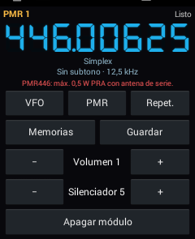
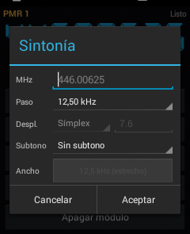

# Walkie UHF

App para usar el **módulo de radio analógico UHF** del PoC **Inrico T298S** (Android 4.4) como un walkie convencional. La app original del fabricante no está publicada en ningún sitio y se pierde con un reset de fábrica. Esta la sustituye, y añade memorias, repetidores, PMR446 y escáner.

<p>
  
  &nbsp;
  
</p>

## Qué hace

- **VFO**: tocando la frecuencia se abre el submenú de sintonía, con la frecuencia tecleada, el paso, el desplazamiento de repetidor (símplex / − / + y su valor), el subtono CTCSS (el mismo en TX y RX) y el ancho (12,5 o 25 kHz).
- **Memorias** con nombre (mantener pulsada una memoria para borrarla).
- **Repetidores UHF**: los 32 canales del plan IARU Región 1 (R70-R101, salida de 438,650 a 439,425 MHz, entrada −7,6 MHz). Cada canal recuerda su subtono.
- **PMR446**: los 16 canales, con un subtono común. El ancho queda fijo en 12,5 kHz.
- **Escáner** en VFO (entre dos límites), memorias, repetidores o PMR. Se para cuando hay señal (al menos 0,3 s seguidos: los golpes cortos de QRM no lo paran), el punto del display late, y sigue siempre a los 5 s de pararse.
- **Indicador de señal** (silenciador abierto).
- **Volumen** (1-8) y **silenciador** (1-8) del módulo. El volumen 1 es el mínimo del módulo: su audio va directo al altavoz y Android no puede bajarlo más.
- Botón **Módulo ON/OFF** (verde/rojo según el estado) y **Salir** (apaga el módulo y cierra la app).
- Display de **7 segmentos** azul neón (en rojo al transmitir).
- **Pitido** suave al soltar el PTT (solo en el altavoz propio) y **LED rojo** del frontal mientras transmite.
- Funciona **con la pantalla apagada** (servicio en primer plano).

### Teclas del T298S

| Tecla | Acción |
|---|---|
| PTT | Transmitir (corte a los 180 s) |
| Botones + / − (bajo el PTT) | Canal o memoria siguiente / anterior; en VFO, un paso arriba / abajo |
| Mantener + / − | Arranca el escáner hacia arriba / abajo |
| PTT, + / − o rueda con el escáner en marcha | Parar el escáner (se queda en ese canal) |
| Rueda | Canal o paso |
| Teclas de volumen | Volumen del módulo |

## Instalación

1. Descarga el APK de la última versión: [WalkieUHF.apk](https://github.com/pyopower/walkie-uhf/releases/latest/download/WalkieUHF.apk) (o desde [Releases](../../releases)).
2. Instálalo en el T298S. Hay que permitir «Orígenes desconocidos» en Ajustes → Seguridad.
3. Ábrela: enciende el módulo sola.

Requisitos: **Inrico T298S con módulo UHF** (400-470 MHz). Puede que funcione en otros PoC con el mismo módulo (busca `/dev/interphone_module` y `/dev/ttyMT0`), pero solo se ha probado en el T298S. No necesita root.

> ⚠️ Con un **cable USB conectado** entra interferencia y el silenciador se abre aunque esté a 8. Es normal: desconecta el cable. Lo mismo con señales muy fuertes o QRM a golpes (p. ej. 433,92 MHz): para eso, subtono.

## Aviso legal

El módulo admite de **400 a 470 MHz**, y eso incluye bandas que no son de radioaficionado. Transmitir es responsabilidad de quien usa la app:

- **70 cm (430-440 MHz)**: solo con licencia de radioaficionado.
- **PMR446**: uso libre, pero con **0,5 W PRA como máximo y la antena de serie**. La potencia de este módulo no se puede ajustar por software y no está medida.
- El resto de la banda: solo con la autorización correspondiente.

Esta app no está relacionada con Inrico ni con el fabricante del módulo, ni cuenta con su apoyo.

## Cómo funciona el módulo (para quien quiera portarlo)

Lo aprendido de la librería que deja el sistema (`/system/lib/libserial_port.so`) y de pruebas en el aparato:

- **Encender / apagar**: `ioctl(open("/dev/interphone_module"), 0x23, &v)` con `v` = 1 / 0.
- **PTT**: el mismo dispositivo, `ioctl` `0x24`, con `v` = 1 / 0.
- **Configuración**: puerto serie **`/dev/ttyMT0` a 9600 8N1**, comandos tipo SA818, con un orden de campos propio:
  - `AT+DMOCONNECT` → `+DMOCONNECT:0`
  - `AT+DMOSETGROUP=ancho,TX,RX,ctcssRX,silenciador,ctcssTX`: ancho 0 = 12,5 kHz, 1 = 25 kHz; frecuencias en MHz con 4 o 5 decimales; CTCSS como índice de 0 a 38 (0 = ninguno, 13 = 103,5 Hz); silenciador de 1 a 8. Responde `:0` si lo acepta y `:1` si no.
  - `AT+DMOSETVOLUME=1..8`
  - `AT+DMOVERQ` → versión (`V1.00.02`)
  - No hay comandos de potencia ni de RSSI.
- **LED del frontal**: `ioctl(open("/dev/led_custom"), 0x23, &v)` = rojo, `0x24` = verde (de `libLedDriver.so`).
- **Audio**: el micro y el altavoz van directos al módulo. El audio de Android no sale al aire, así que no hay roger beep ni eco hacia los demás.
- **Estado del silenciador**: GPIO **136** (salida del módulo), legible sin root en `/sys/devices/virtual/misc/mtgpio/pin` (tercera cifra de la línea `136:`; `0` = hay señal).
- **Teclas**: el sistema manda avisos (broadcasts): `android.intent.action.PTT.down/up`, `android.intent.zrk.button1.down/up` (+), `android.intent.zrk.button2.down/up` (−) y `android.intent.channel.inc.down/dec.down` (rueda).

## Compilar

```bash
./gradlew assembleDebug
```

Necesita el Android SDK con el **NDK 25.2.9519653** (el último que compila para Android 4.4). GitHub Actions compila el APK en cada cambio. Al subir una etiqueta `vX.Y.Z` publica una release con el APK firmado.

## Licencia

[GPL-3.0](LICENSE). El display usa la fuente [DSEG7 Classic](https://github.com/keshikan/DSEG) de keshikan, con licencia [OFL-1.1](app/src/main/assets/dseg7-OFL.txt).
